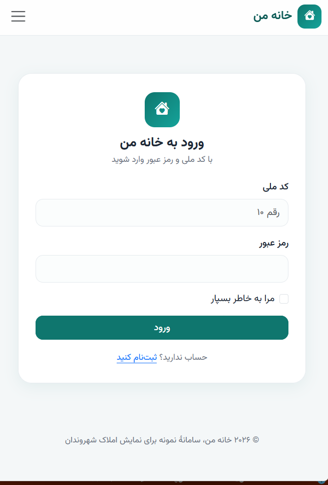
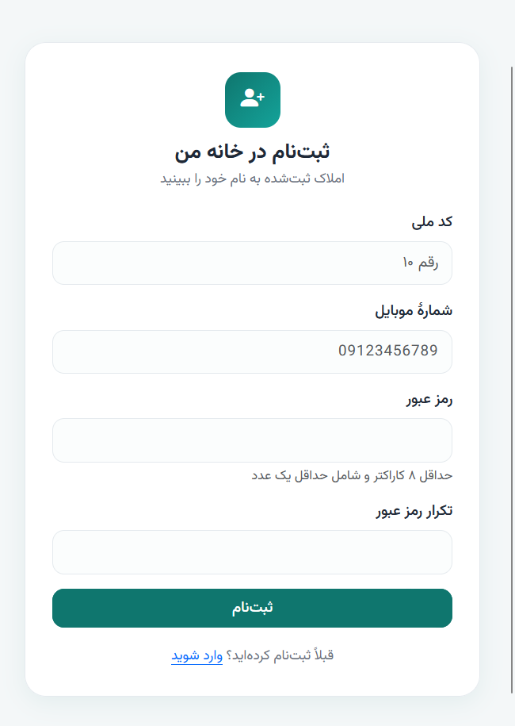
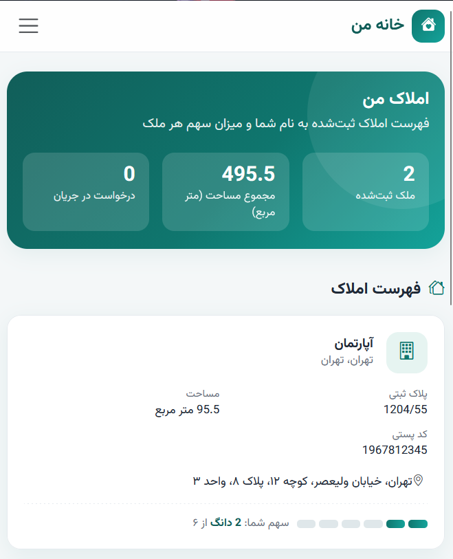
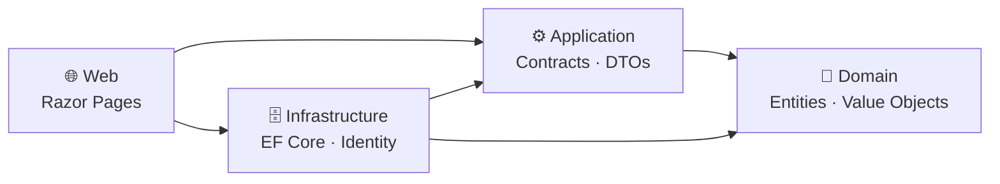
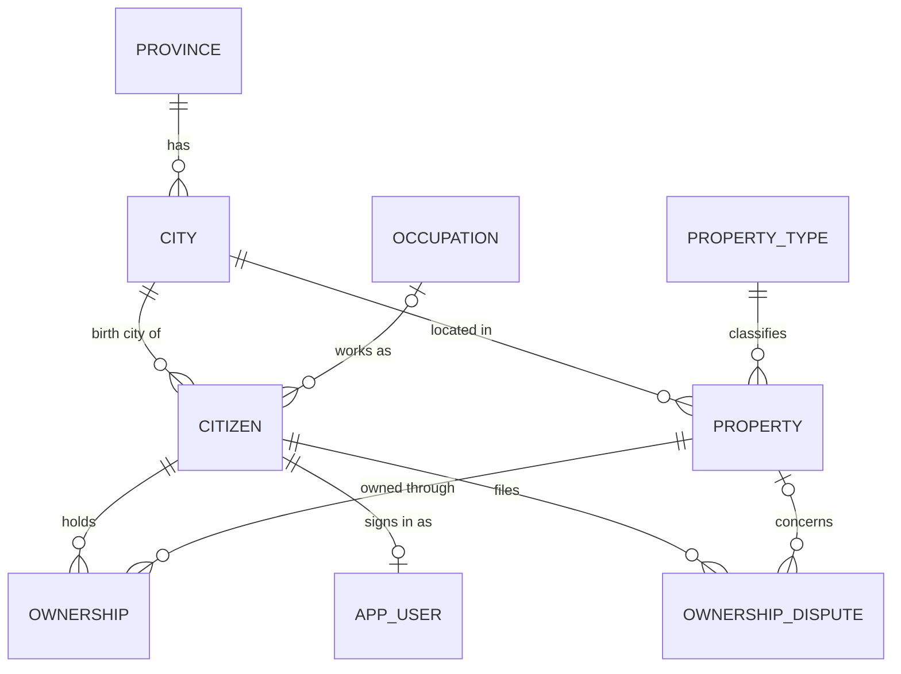

<div align="center">

# 🏠 HouseOfMine (خانه من)

**A Persian, right-to-left real-estate portal where citizens sign in with their national code and see every property registered in their name.**

[](https://dotnet.microsoft.com/)
[](https://learn.microsoft.com/dotnet/csharp/)
[](https://learn.microsoft.com/ef/core/)
[](https://www.microsoft.com/sql-server)
[](https://getbootstrap.com/)
[](LICENSE)

[Features](#-features) •
[Screenshots](#-screenshots) •
[Architecture](#-architecture) •
[Data Model](#-data-model) •
[Getting Started](#-getting-started) •
[Roadmap](#-roadmap)

</div>

---

## ✨ Features

| | |
|---|---|
| 🔐 **National-code authentication** | Register and sign in with a national code, mobile number and password, built on ASP.NET Core Identity. |
| ✅ **Real national-code validation** | Codes are verified with the official check-digit algorithm inside a domain value object, not just a regex. |
| 🏘️ **My Properties** | After login, every property owned by the signed-in citizen is listed with type, location, area, postal code and a visual ownership-share meter (dong out of 6). |
| 🤝 **Shared ownership** | A property can have several owners, each with their own share, modeled with a many-to-many `Ownership` entity. |
| 📝 **Correction requests** | If a property is missing or wrongly registered, the citizen files a request, tracks its status, and support can resolve it. |
| 🌐 **Persian, RTL interface** | Bootstrap 5 RTL, Vazirmatn font, responsive layout, custom teal design system. |
| 🌱 **Valid seed data** | Sample citizens are generated with correct check digits, so the data is realistic and passes the same validation as real input. |

## 📸 Screenshots

| Sign in | Register | My Properties |
|:---:|:---:|:---:|
|  |  |  |

## 🧱 Architecture

The solution follows a lightweight **Clean Architecture**. Dependencies always point inward, toward the domain.



| Layer | Responsibility | Depends on |
|---|---|---|
| **Domain** | Entities, enums, value objects (`NationalCode`), business rules | nothing |
| **Application** | Service interfaces (`IAuthService`, `IPropertyService`, `IDisputeService`), DTOs, `OperationResult` | Domain |
| **Infrastructure** | `AppDbContext`, Fluent API configurations, migrations, Identity, service implementations, seeding | Application, Domain |
| **Web** | Razor Pages, page models, validation, layout, composition root | Application, Infrastructure |

### Design principles used

- **Dependency Injection** everywhere. Pages depend on interfaces, never on EF Core or Identity directly.
- **Rich domain model.** Entities have private setters and enforce invariants in constructors and methods (for example, ownership share must be 1 to 6 dong, a death date cannot precede the birth date).
- **Value object** for `NationalCode`, with validation and EF Core value conversion to `char(10)`.
- **Fluent API configuration** in one class per entity, loaded with `ApplyConfigurationsFromAssembly`.
- **Replaceable infrastructure.** All registrations live in a single `AddInfrastructure()` extension method, so the database or auth mechanism can change without touching the web layer.
- **Authorization by default.** Every page requires login except sign in, register, privacy and error.

## 🗃️ Data Model



Key constraints enforced in the database:

- Unique national code per citizen, unique registration number per property
- One account per citizen, unique mobile number per account
- `CHECK (ShareDong BETWEEN 1 AND 6)` on ownership
- One ownership row per (property, citizen) pair
- All foreign keys use `Restrict` delete behavior to prevent accidental cascades

## 🔒 Security notes

- The national code is **bound to the account at registration** and is never entered again on the home page, so users cannot look up other people's properties.
- Passwords are hashed by ASP.NET Core Identity. Policy: minimum 8 characters with at least one digit.
- Account lockout after 5 failed attempts for 10 minutes.
- Login errors are intentionally generic, so the app does not reveal which national codes exist.
- Anti-forgery tokens are enabled on all forms by default (Razor Pages).
- Database connection strings are kept out of source control (see below).

> ⚠️ This is a learning project with **fake data**. It does not connect to any real civil registry or property registry, and mobile verification (OTP) is not implemented yet.

## 🚀 Getting Started

### Prerequisites

- [.NET 10 SDK](https://dotnet.microsoft.com/download)
- SQL Server 2017 or newer (LocalDB, Express or full edition)
- Visual Studio 2026 or any editor with the .NET CLI

### Run it

```bash
git clone https://github.com/YOUR_USERNAME/HouseOfMine.git
cd HouseOfMine
dotnet run --project HouseOfMine.Web
```

In the Development environment the app **applies migrations and seeds sample data automatically** on startup. Open the HTTPS address printed in the console.

### Use your own SQL Server

The default connection string targets LocalDB. To use another instance, store your own connection string in [User Secrets](https://learn.microsoft.com/aspnet/core/security/app-secrets) so it never reaches source control:

```bash
dotnet user-secrets init --project HouseOfMine.Web
dotnet user-secrets set "ConnectionStrings:DefaultConnection" "Server=.\SQLEXPRESS;Database=HouseOfMineDb;Trusted_Connection=True;TrustServerCertificate=True" --project HouseOfMine.Web
```

### Try the sample data

Register with one of the seeded national codes. Choose any mobile number starting with `09` and your own password.

| Citizen | National code | Properties |
|---|---|---|
| Ali Rezaei | `1234567891` | 4 dong of an apartment in Tehran |
| Maryam Ahmadi | `2345678909` | 2 dong of the same apartment, plus a full plot in Isfahan |
| Reza Karimi | `3456789017` | A shop in Shiraz |

### Working with migrations

```bash
dotnet tool install --global dotnet-ef --version "10.*"

dotnet ef migrations add <Name> --project HouseOfMine.Infrastructure --startup-project HouseOfMine.Web
dotnet ef database update      --project HouseOfMine.Infrastructure --startup-project HouseOfMine.Web
```

## 📁 Project Structure

```text
HouseOfMine
├── HouseOfMine.Domain
│   ├── Common/            Entity base class
│   ├── Entities/          Citizen, Property, Ownership, OwnershipDispute, City, ...
│   ├── Enums/             Gender, MaritalStatus, DisputeStatus
│   └── ValueObjects/      NationalCode (check-digit validation)
├── HouseOfMine.Application
│   ├── Auth/              IAuthService, RegisterRequest, AuthResult
│   ├── Properties/        IPropertyService, OwnedPropertyDto
│   ├── Disputes/          IDisputeService, DisputeDto, CreateDisputeRequest
│   └── Common/            OperationResult
├── HouseOfMine.Infrastructure
│   ├── Identity/          AppUser, AuthService
│   ├── Persistence/       AppDbContext, Configurations/, DbSeeder, Migrations/
│   ├── Services/          PropertyService, DisputeService
│   └── DependencyInjection.cs
└── HouseOfMine.Web
    ├── Pages/             Index, Account/Login, Register, Logout
    └── wwwroot/           Site styles and static assets
```

## 🛠️ Tech Stack

| Area | Technology |
|---|---|
| Runtime and language | .NET 10, C# |
| Web framework | ASP.NET Core Razor Pages |
| Data access | Entity Framework Core 10 (Code First, migrations, Fluent API) |
| Database | Microsoft SQL Server 2017+ |
| Authentication | ASP.NET Core Identity with integer keys |
| UI | Bootstrap 5.3 RTL, Bootstrap Icons, Vazirmatn font |

## 🗺️ Roadmap

- [ ] OTP-based mobile verification
- [ ] Persian (Jalali) calendar display for all dates
- [ ] Admin panel for support staff to review and resolve correction requests
- [ ] Unit tests for the domain layer and integration tests for services
- [ ] Docker Compose setup with SQL Server
- [ ] GitHub Actions workflow for build and test
- [ ] Self-hosted fonts and icons for fully offline use

## 🤝 Contributing

Issues and pull requests are welcome. Please open an issue first to discuss any significant change.

## 📄 License

Distributed under the MIT License. See [`LICENSE`](LICENSE) for details.

---

<div align="center">
Built with ❤️ as a hands-on project in clean architecture with .NET.
</div>
